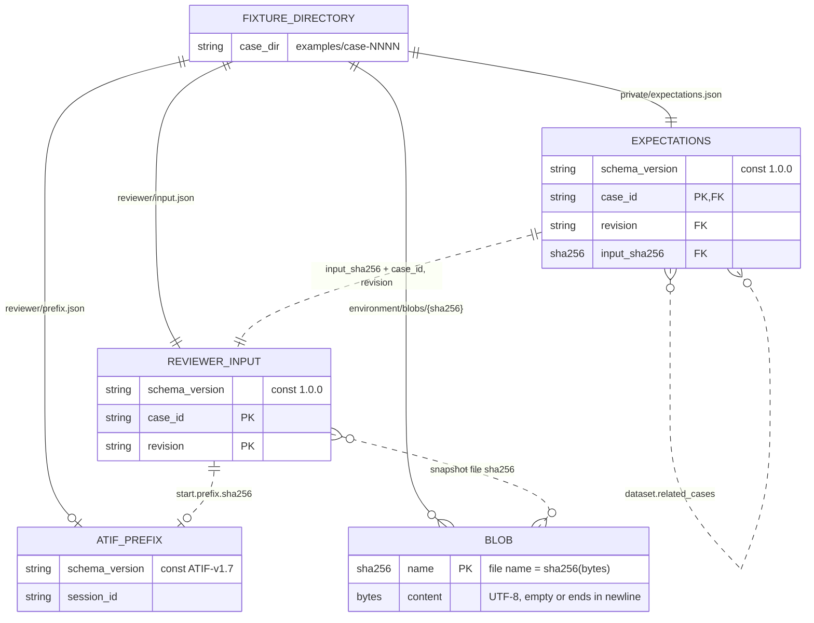
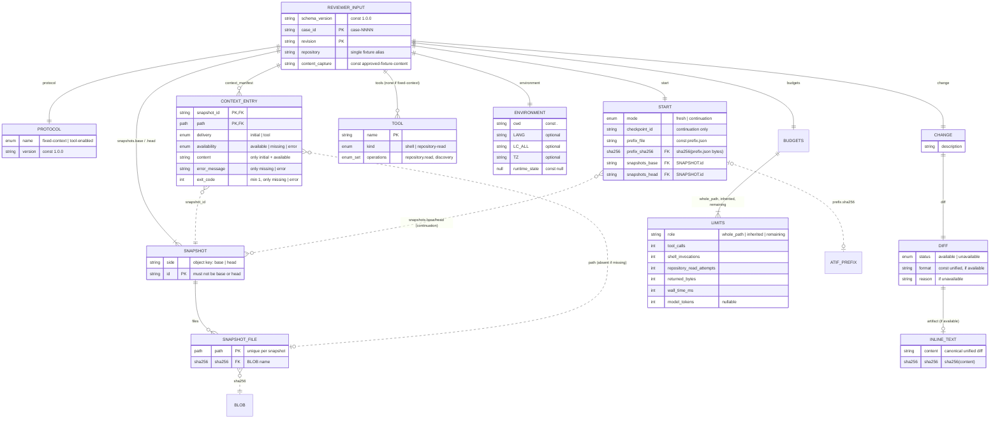
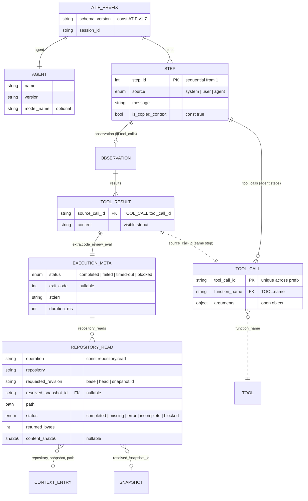

# Schema entity relationship diagrams

Entity relationship diagrams for the fixture contracts in `schemas/`:

| Schema | Document | Root entity |
|---|---|---|
| `reviewer-input.schema.json` | `reviewer/input.json` | `REVIEWER_INPUT` |
| `atif-prefix.schema.json` | `reviewer/prefix.json` (continuation only) | `ATIF_PREFIX` |
| `expectations.schema.json` | `private/expectations.json` | `EXPECTATIONS` |
| `common.schema.json` | Shared `$defs` only | — |

**Notation.**

- A solid line (`--`) means the JSON Schema nests the child object inside the
  parent.
- A dotted line (`..`) means one value refers to another by ID, path, or hash.
  The schemas do not check these references. `validate_fixtures.py` checks
  them.
- `PK` marks an identifier that the validator requires to be unique within its
  scope.
- `FK` marks a value that must match an identifier elsewhere.
- Attribute types `path` and `sha256` are the common canonical relative path
  and 64-character lowercase hex digest. `enum` lists the allowed values in the
  comment.
- A box without attributes is either a container object with only child
  entities, such as `BUDGETS`, or an entity from another diagram.

Mermaid cannot express fixed cardinalities. `snapshots` always has exactly two
members (`base` and `head`). `budgets` always has exactly three `LIMITS`
(`whole_path`, `inherited` and `remaining`).

## Overview: documents in one fixture

## Reviewer input (`reviewer-input.schema.json`)

## ATIF continuation prefix (`atif-prefix.schema.json`)

`tool_result` and `repository_read` are defined in `common.schema.json`.

## Private expectations (`expectations.schema.json`)

```mermaid
erDiagram
    EXPECTATIONS ||--|| DATASET : dataset
    DATASET ||--o{ RELATED_CASE : related_cases
    EXPECTATIONS ||--|| LABELS : labels
    EXPECTATIONS ||--|| PROVENANCE : provenance
    PROVENANCE ||--o{ PROVENANCE_SOURCE : "sources (iff derived)"
    PROVENANCE ||--|| VERIFICATION : verification
    EXPECTATIONS ||--|| EXPECTATION_SET : expectations
    EXPECTATION_SET ||--o{ REQUIRED_FINDING : required_findings
    REQUIRED_FINDING ||--|{ LOCATION : locations
    REQUIRED_FINDING ||--|{ EVIDENCE : evidence
    EXPECTATION_SET ||--o{ NON_FINDING : non_findings
    EXPECTATION_SET ||--|| CONTEXT_EXPECTATION : context
    EXPECTATION_SET ||--|| RETRIEVAL : retrieval
    RETRIEVAL ||--o{ RETRIEVAL_REQUIREMENT : requirements
    RETRIEVAL_REQUIREMENT ||--|{ SOURCE : acceptable_sources
    RETRIEVAL ||--|| SOFT_BUDGET : soft_budget
    EXPECTATION_SET ||--o| CONTINUATION_EXPECTATION : "continuation (null if fresh)"
    CONTINUATION_EXPECTATION ||--o{ REMAINING_ACTION : required_remaining_actions
    CONTINUATION_EXPECTATION ||--o{ ORDER_CONSTRAINT : essential_order
    EXPECTATION_SET ||--|| INSTRUCTION_HANDLING : instruction_handling

    EXPECTATIONS ||..|| REVIEWER_INPUT : "input_sha256, case_id, revision"
    RELATED_CASE }o..o| EXPECTATIONS : "case_id (other case)"
    ORDER_CONSTRAINT }o..o{ REMAINING_ACTION : "before / after"
    ORDER_CONSTRAINT }o..o{ RETRIEVAL_REQUIREMENT : "before / after"
    LOCATION }o..|| SNAPSHOT_FILE : "side + path"
    SOURCE }o..|| CONTEXT_ENTRY : "must be available"

    EXPECTATIONS {
        string schema_version "const 1.0.0"
        string case_id PK,FK "case-NNNN"
        string revision FK
        sha256 input_sha256 FK "sha256(input.json bytes)"
    }
    DATASET {
        string id
        string version
        enum partition "development | held-out"
        string group_id
    }
    RELATED_CASE {
        string case_id FK
        enum relationship "defect-fix | adversarial-variant | checkpoint | semantic-variant"
    }
    LABELS {
        string_set languages "min 1"
        enum primary_concern "one of 7 concern categories"
        enum_set secondary_concerns "same 7 categories"
        enum change_outcome "defective | clean | undetermined"
    }
    PROVENANCE {
        enum kind "original | derived"
        string licence
        string permission
    }
    PROVENANCE_SOURCE {
        string repository
        string fix_revision
        string parent_revision
        path_list paths "min 1"
        enum synthesis "faithful-reduction | inspired-mutation"
        string changes
    }
    VERIFICATION {
        enum status "pending | independently-reviewed"
        string notes
    }
    EXPECTATION_SET {
        string final_review_behavior
    }
    REQUIRED_FINDING {
        string id PK "unique across expectation IDs"
        string explanation
        enum severity "critical | high | medium | low"
        string severity_rationale
        string discoverable_because
    }
    LOCATION {
        path path FK
        enum side "base | head"
        int lines_start "lines nullable, min 1"
        int lines_end "lines_start <= lines_end"
    }
    EVIDENCE {
        enum kind "manual-scenario | reproducer"
        string description
    }
    NON_FINDING {
        string id PK
        string allegation
        string reason
    }
    CONTEXT_EXPECTATION {
        enum condition "self-contained | project-dependent | insufficient"
        string expected_behavior
    }
    RETRIEVAL_REQUIREMENT {
        string id PK
        enum evidence_origin "available-evidence | new-suffix"
        string rationale
    }
    SOURCE {
        string repository FK
        string snapshot_id FK
        path path FK
    }
    SOFT_BUDGET {
        int repository_read_attempts
        int returned_bytes
        int repeated_reads
    }
    CONTINUATION_EXPECTATION {
        string_list forbidden_actions
        string_list acceptable_alternatives
    }
    REMAINING_ACTION {
        string id PK
        string description
    }
    ORDER_CONSTRAINT {
        string before FK "action, requirement or final_review"
        string after FK "action, requirement or final_review"
    }
    INSTRUCTION_HANDLING {
        string expected_behavior
    }
```

`source` and `location` are defined in `common.schema.json`.

## Shared definitions (`common.schema.json`)

| `$def` | Entity in diagrams | Used by |
|---|---|---|
| `path` | `path` attribute type | input, prefix, expectations |
| `checksum` | `sha256` attribute type | input, prefix, expectations (pattern also inlined) |
| `case_id` | `case_id` attributes | input, expectations |
| `snapshot` | `SNAPSHOT`, `SNAPSHOT_FILE` | input |
| `inline_text` | `INLINE_TEXT` | input |
| `environment` | `ENVIRONMENT` | input |
| `limits` | `LIMITS` | input |
| `tool_result` | `TOOL_RESULT`, `EXECUTION_META` | prefix |
| `repository_read` | `REPOSITORY_READ` | prefix (via `tool_result`) |
| `location` | `LOCATION` | expectations |
| `source` | `SOURCE` | expectations |

## Validator-enforced relationships

The schemas cannot express the dotted relationships. `validate_fixtures.py`
checks them:

- `EXPECTATIONS.input_sha256` must equal the SHA-256 of the exact bytes in
  `reviewer/input.json`. `case_id`, `revision` and `schema_version` must match
  across the two documents.
- `START.prefix.sha256` must equal the SHA-256 of the exact bytes in
  `reviewer/prefix.json`. The prefix file must exist exactly when
  `start.mode` is `continuation`. `EXPECTATION_SET.continuation` must be
  non-null in the same condition.
- Every `SNAPSHOT_FILE.sha256` must name a blob whose content hashes to that
  value.
- Each `CONTEXT_ENTRY.snapshot_id` must refer to a snapshot. An `available`
  path must exist in that snapshot, and a `missing` path must not. An `error`
  path may or may not exist.
- `TOOL_CALL.function_name` must name a declared `TOOL`. Each call must have
  exactly one `TOOL_RESULT` on the same step.
- A completed `REPOSITORY_READ` must match an available `CONTEXT_ENTRY`. Its
  byte count and hash must match the snapshot file.
- `LOCATION` (`side`, `path`, line range) must fall within the selected
  snapshot's file.
- Each `SOURCE` must identify an available `CONTEXT_ENTRY`.
- `ORDER_CONSTRAINT.before` and `ORDER_CONSTRAINT.after` must refer to a
  `REMAINING_ACTION` ID, a `RETRIEVAL_REQUIREMENT` ID, or the reserved ID
  `final_review`. The constraints must not form a cycle.
- Each `RELATED_CASE` that is validated with its target must share the
  target's dataset `id`, `version`, `partition` and `group_id`.
