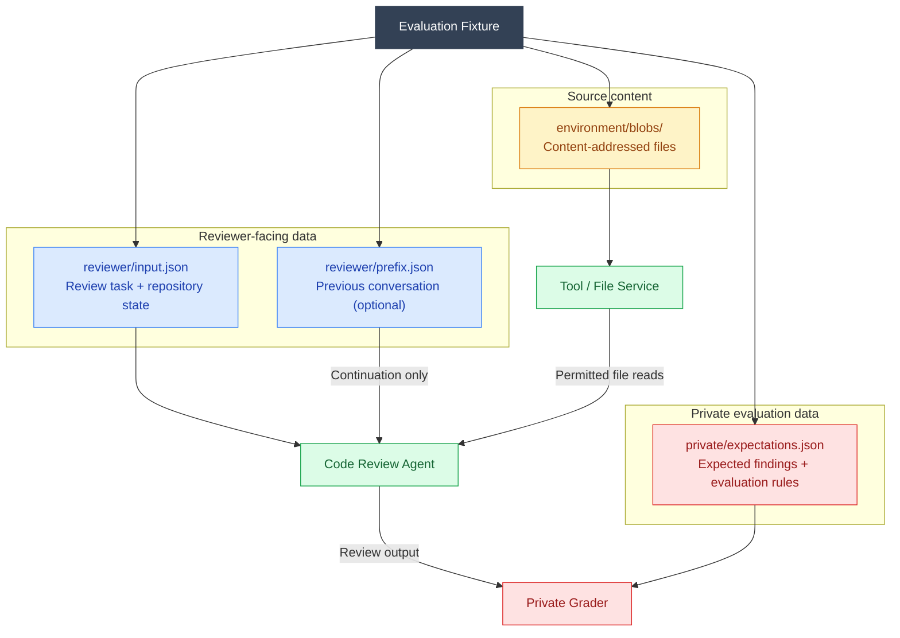
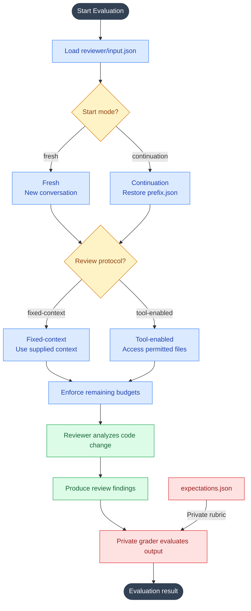
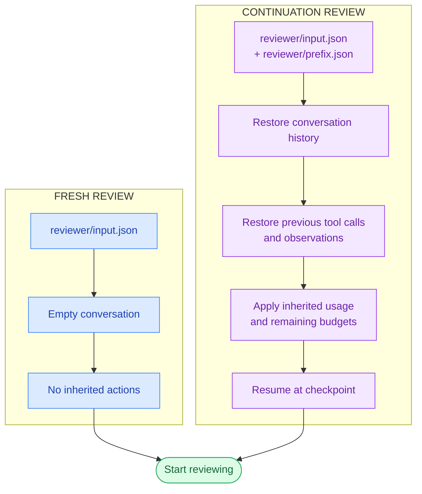
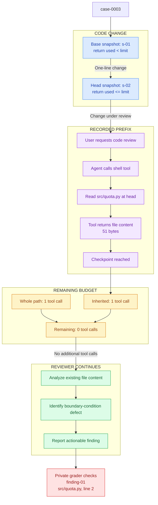
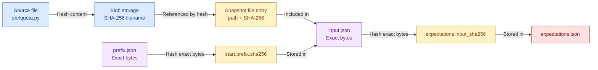
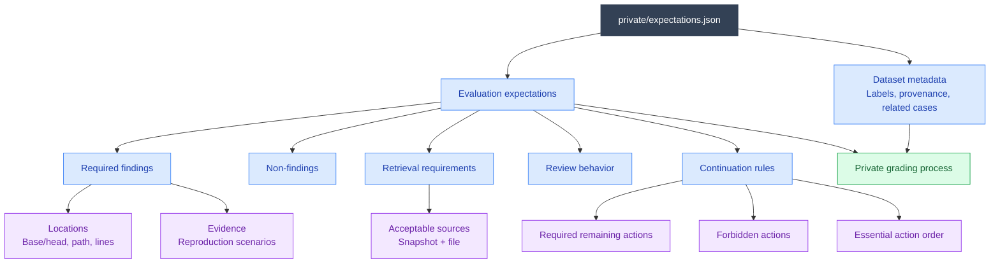

# Fixture diagrams

These six Mermaid diagrams explain the fixture format to an audience. Each
diagram covers a different level of detail.

## 1. System architecture — What is a fixture?

## 2. Evaluation lifecycle — How does a review run?

## 3. Fresh vs. continuation — Two starting modes

## 4. Real case walkthrough — `case-0003`

This diagram walks through the most instructive example: a code change, a
previously completed file read, and no remaining tool calls.

## 5. SHA-256 integrity — How documents are linked

## 6. Expectations — What does the grader evaluate?

## Presenting the diagrams

For a live demo, present them in the order 1 → 2 → 4 → 3 → 5 → 6. That moves
from the overall architecture to a real example before introducing the more
technical aspects of the schemas.

To export SVG or PNG files for a presentation, paste each diagram into the
[Mermaid Live Editor](https://mermaid.live/).
